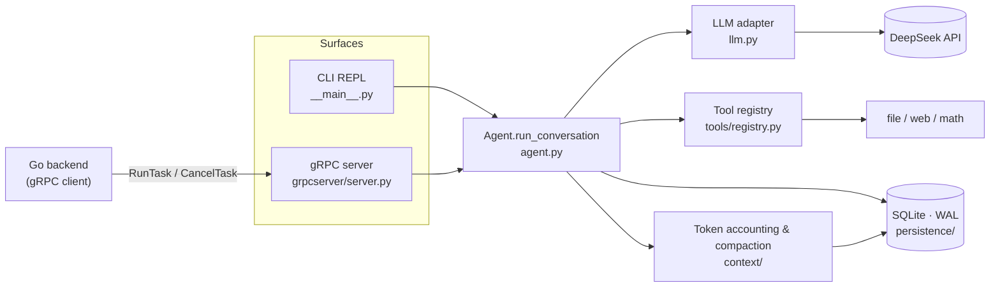

<div align="center">

# mini-agent

**A minimal AI agent runtime built from scratch — a "mini Hermes".**

ReAct tool loop · crash recovery with exactly-once tool execution · automatic context compaction · CLI and gRPC surfaces

[](pyproject.toml)
[](mini_agent/llm.py)
[](mini_agent/persistence/session_db.py)
[](mini_agent/grpcserver/server.py)

[简体中文](README.md) | **English**

</div>

---

## What is this

mini-agent is a **learning project**. It implements the core of an agent runtime from scratch — plain Python plus the official OpenAI-compatible SDK, no LangChain-style framework — and every design decision is meant to be explainable: why it is this way, and what was rejected.

It follows the architectural ideas of [Hermes Agent](https://github.com/NousResearch/hermes-agent) but stays deliberately small: DeepSeek only, no multi-provider adapters. The focus is **correctness**, especially the failures that never show up in a demo and only bite in production — will a side-effecting tool run again after the process is killed? Will results be mis-paired when the model reuses a tool_call id?

It is not a ready-to-use product. If you want an agent to use, look at Hermes or other mature projects. If you want to see how an agent runtime is put together *inside*, that is what this code and its comments are written for.

## Features

| | |
|---|---|
| **ReAct tool loop** | When the model returns `tool_calls`, they are executed and the results fed back, until it answers in plain text. `IterationBudget` caps the number of turns; when it runs out, one final request without tools forces a text answer instead of looping forever. |
| **Crash recovery, exactly-once tools** | Every message is written to SQLite (WAL) immediately. The idempotency record is committed before the tool result, so if the process dies between the two writes, `--resume` restores the real result from the idempotency table — side-effecting tools are **never re-run**. |
| **Automatic context compaction** | The size of the next request is computed as "last request's usage as an anchor + an estimate of what was added". Past a threshold, the middle of the history is rolled into a summary checkpoint. Failures degrade gracefully; if the provider rejects a request as too long, one compaction is forced and the call retried. |
| **Tool system** | Tools self-register on import and are sorted by name (so DeepSeek's prefix cache can hit). `dispatch()` never raises; errors come back as JSON. Built-ins: sandboxed file read/write, `web_search`, and `web_fetch` with SSRF protection. |
| **Two equal surfaces** | A CLI REPL, and a server-streaming gRPC API (`RunTask`) for a Go backend, with progress events and task cancellation. |
| **Secure by default** | The file-tool sandbox root is kept apart from the repo, so the model cannot read `.env`. gRPC binds to loopback by default and refuses to start on any other address without a valid token. Secret fields never enter `repr()`. |

## Architecture



The `Agent` itself is **stateless**: one instance serves every session, `session_id` is passed in on each call, and the database is the single source of truth for history. One `run_conversation` looks roughly like this:

```text
load history from the DB (incl. compaction checkpoint) → record the user message
loop:
    need to compact? → compact first
    call the model (rejected as too long → force one compaction, retry once only if the view changed)
    got tool_calls?
        yes → run each: truncate oversized output → write idempotency row → write tool message → loop
        no  → plain-text answer, turn ends
```

## Quick start

**Requirements:** Python ≥ 3.11 and a [DeepSeek API key](https://platform.deepseek.com/api_keys).

```bash
# 1. Install (editable + dev dependencies)
pip install -e ".[dev]"

# 2. Generate gRPC code (not committed; without it the gRPC surface and its tests won't run)
python -m grpc_tools.protoc \
  --proto_path=mini_agent/proto \
  --python_out=mini_agent/gen \
  --grpc_python_out=mini_agent/gen \
  --pyi_out=mini_agent/gen \
  mini_agent/proto/agent/v1/agent.proto

# 3. Configure
cp .env.example .env          # fill in DEEPSEEK_API_KEY
```

**CLI**

```bash
python -m mini_agent                     # new session (prints its session id)
python -m mini_agent --resume sess_xxxx  # recover and continue a previous session
```

**gRPC server**

```bash
python -m mini_agent.grpcserver.server   # defaults to 127.0.0.1:50051
```

Runtime state (`state.db`, logs, the tool workspace) lives under `./.mini_agent/`, which is gitignored; delete it to reset.

## Configuration

Everything is configured through environment variables (or `.env`); defaults live in [`mini_agent/config.py`](mini_agent/config.py).

| Variable | Default | Notes |
|---|---|---|
| `DEEPSEEK_API_KEY` | — | **Required** |
| `MINI_AGENT_MODEL` | `deepseek-flash` | `deepseek-v4-pro` also works |
| `MINI_AGENT_BASE_URL` | `https://api.deepseek.com` | OpenAI-compatible endpoint |
| `MINI_AGENT_MAX_TURNS` | `25` | Max tool-loop turns per task |
| `MINI_AGENT_REQUEST_TIMEOUT` | `120` | Per-LLM-call timeout (seconds) |
| `MINI_AGENT_HOME` | `./.mini_agent` | Runtime state root |
| `MINI_AGENT_WORKSPACE` | `<HOME>/workspace` | The **only** directory file tools can touch |
| `MINI_AGENT_COMPRESSION` | on | `0` / `false` / `no` / `off` disables compaction |
| `MINI_AGENT_CONTEXT_WINDOW` | `128000` | A **budget** window (deliberately below the model limit) that decides when compaction starts |
| `MINI_AGENT_COMPRESS_TRIGGER_RATIO` | `0.5` | Compact once a request reaches `ratio × window` |
| `MINI_AGENT_TOOL_OUTPUT_MAX_TOKENS` | `window // 10` | Per-call tool output cap; longer output is truncated |
| `MINI_AGENT_GRPC_HOST` | `127.0.0.1` | A non-loopback address **requires** a token |
| `MINI_AGENT_GRPC_PORT` | `50051` | Must match the Go side's `AGENT_ADDR` |
| `MINI_AGENT_GRPC_MAX_WORKERS` | `16` | Concurrency limit (each task uses two threads) |
| `MINI_AGENT_GRPC_TOKEN` | empty | Shared secret: ≥ 32 bytes, visible ASCII only, same value as the Go side's `AGENT_GRPC_TOKEN` |
| `MINI_AGENT_LOG_LEVEL` / `_LOG_DIR` / `_LOG_CONSOLE` | `INFO` / `<HOME>/logs` / `1` | Logging |

## Design notes

These are the decisions most worth discussing. The full reasoning — including the bugs that led to each one and the regression tests that guard it — is in [`CLAUDE.md`](CLAUDE.md).

- **Exactly-once tool execution.** `_execute_tool_calls` writes the idempotency record before the tool message. If the process dies in between, `recover()` finds the tool_call with no result and restores the real one from the idempotency table. If there is nothing there either, it inserts an `interrupted` placeholder to keep the pairing valid (a dangling `tool_calls` makes the next request fail with 400) and lets the model decide whether to retry.

- **The idempotency key contains no model input.** The primary key is `(session_id, assistant_seq, tool_index)` — all server-owned data; the model's `tool_call.id` is only a validation column. An earlier version used the model's id as a global key, which leaked results across sessions (a privacy issue) and returned the wrong round's result within a session. Pairing is also **per window**: an assistant message only claims the tool messages directly after it.

- **Recovery degrades, never raises.** `recover()` reads *historical data*, not program state. Corrupt JSON rows, empty ids and wrongly typed cached content are skipped or stubbed and logged — never raised. Otherwise a single bad row would make that session impossible to `--resume`, forever.

- **Versioned schema.** `PRAGMA user_version` records the version. The fast path only reads and never takes the write lock; migration re-checks the version inside `BEGIN IMMEDIATE`, so concurrent openers migrate exactly once. Old tables are renamed, never dropped.

- **Token count = anchor + estimate.** The last response's `usage` describes the previous request and has not seen anything added since — typically the very large tool result. So the most recent usage whose prefix fingerprint still matches is used as the anchor, plus an estimate of the new content. Estimates are biased high: the worst outcome is compacting a bit early, not missing the trigger.

- **Compaction never touches the newest round.** A tool result the model has not read yet is never summarized away; the last user message is copied into the checkpoint **verbatim**, taken from the DB so the model cannot paraphrase it. If summarization fails, old tool outputs are pruned in memory only. If the provider rejects a request as too long, one compaction is forced, and the call is retried only if the view actually changed — at most once.

- **Concurrency safety.** The gRPC surface is multi-threaded. **Every** access to the SQLite connection, reads included, holds a lock: `check_same_thread=False` only disables the check, it does not make the connection thread-safe. Unguarded concurrent reads once returned rows with `content=None`, silently dropping messages.

## Project layout

```text
mini_agent/
├── agent.py              # the loop, run_conversation (stateless handler)
├── llm.py                # the only place that talks to the network; DeepSeek adapter
├── config.py             # central config; anything both surfaces need lives here
├── schema.py             # internal message format (OpenAI-shaped)
├── log.py                # logging
├── __main__.py           # CLI surface
├── grpcserver/server.py  # gRPC surface (protocol layer: callbacks → event stream)
├── proto/  gen/          # agent.v1 contract / generated code (generated files not committed)
├── tools/
│   ├── registry.py       # registry, discovery, dispatch
│   ├── model_tools.py    # sync → async bridge
│   └── builtin/          # file_tools · web_tool · add_tool
├── persistence/          # SessionDB (WAL), tables and schema migration
└── context/              # token accounting, compaction trigger, LLMCompressor
tests/                    # pytest; no API key or network needed
开发路线.md                # the original M0→M5 design blueprint, in Chinese (not a description of current state)
```

These files are currently **empty placeholders** — don't assume a feature exists because its file does: `loop.py`, `budget.py`, `delegate.py`, `prompt.py`, `cli.py`, `memory/*`, `tools/{dispatch,executor,state_tools}.py`, `tools/builtin/shell_tool.py`.

## Testing

```bash
pytest                  # everything
pytest -m "not slow"    # day-to-day: skips the subprocess crash tests
pytest -m slow          # only the real process-kill crash-recovery tests
```

Tests need no API key and no network: the `fake_llm` fixture in `tests/conftest.py` replaces `mini_agent.agent.call_llm` with scripted responses, which makes the whole loop deterministic.

> `tests/test_delegate.py` and `tests/test_memory.py` are empty and collect nothing. A green run says nothing about M4 / M5 — those parts aren't written yet.

## gRPC API

<details>
<summary><b>Event contract</b>: event types pushed by <code>RunTask</code> and how the Go side handles them</summary>

<br/>

`RunTask` is server-streaming. The event type strings match the constants of the Go side's `agentclient.EventType` exactly — **change one side, change the other**.

| Event | When | Go side |
|---|---|---|
| `started` | As soon as the stream opens | → `running` |
| `thinking` | Text that comes with a `tool_calls` response | log only |
| `tool_call` | **Before** each dispatch | log only |
| `tool_result` | After each tool finishes | log only |
| `compacting` / `compacted` | Compaction starts / ends (`compacted` carries an `ok` field) | Currently sent as `EVENT_TYPE_UNSPECIFIED` with a readable payload; adding dedicated enum values to the proto is a cross-repo change not yet made |
| `finished` | `run_conversation` returns normally | → `succeeded` |
| `error` | The task raised (payload has no traceback, truncated to 2000 chars) | → `failed`, payload is the failure reason |

**A cancelled task sends no terminal event** — the stream simply ends (EOF). The Go side persists before it notifies, so the DB already says `canceled`; another terminal event would overwrite it.

</details>

<details>
<summary><b>After changing the .proto</b>: sync and regenerate</summary>

<br/>

The **source of truth for the `.proto` is the backend repo** (`backend/proto/agent/v1/agent.proto`); `mini_agent/proto/` here is a copy. The right order is: change the backend copy → copy it over → regenerate on both sides.

```bash
# 1. Sync from the backend (the two copies must be byte-identical)
cp ../backend/proto/agent/v1/agent.proto mini_agent/proto/agent/v1/agent.proto

# 2. Regenerate the code under mini_agent/gen/
python -m grpc_tools.protoc \
  --proto_path=mini_agent/proto \
  --python_out=mini_agent/gen \
  --grpc_python_out=mini_agent/gen \
  --pyi_out=mini_agent/gen \
  mini_agent/proto/agent/v1/agent.proto
```

The generated `*_pb2*.py` files are gitignored; the hand-written `__init__.py` files under `mini_agent/gen/` are committed. The top-level one carries a **required** `sys.path` patch, because protoc-generated code imports itself as top-level `from agent.v1 import ...`.

</details>

## Roadmap

Milestones follow [`开发路线.md`](开发路线.md) (in Chinese):

| Milestone | Scope | Status |
|---|---|---|
| M0 | Minimal chat loop, `IterationBudget` | ✅ |
| M1 | Tool system: registry, dispatch, file and web tools | ✅ (`shell_tool` and a parallel executor not done) |
| M2 | Persistence and crash recovery (exactly-once) | ✅ |
| M2.5 | Stateless agent, in preparation for serving | ✅ |
| M3 | Token accounting, compaction, overflow fallback, tool output cap | ✅ (`recover()` still loads full history; checkpoint reuse lives in `load_context`) |
| M4 | Subagent delegation | ⬜ not started (lineage columns already reserved in `sessions`) |
| M5 | Self-improvement: memory and skills | ⬜ not started |
| — | Second surface: gRPC server | ✅ |
| — | GitHub Actions CI | 🚧 in progress |

## Two hard rules

Read these before writing code here; they override `开发路线.md`:

1. **DeepSeek only**, via the OpenAI-compatible SDK (`base_url=https://api.deepseek.com`). No multi-provider adapters, no `provider` parameter, no `to_anthropic()`-style branches.
2. **Absolute imports only:** always `from mini_agent.xxx import ...`, never relative or bare module names. Otherwise the same code gets loaded under two module identities — tools register twice, `monkeypatch` stops working, and `isinstance` checks break.

## Acknowledgements

The architecture is inspired by [Hermes Agent by Nous Research](https://github.com/NousResearch/hermes-agent).

## License

No license has been chosen yet. Until a LICENSE file is added, all rights are reserved.
