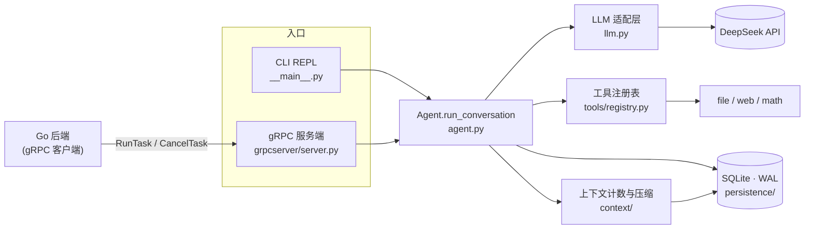

<div align="center">

# mini-agent

**从零手写的最小 AI Agent 运行时 —— 一个"迷你 Hermes"。**

ReAct 工具调用循环 · 崩溃可恢复且工具只执行一次 · 上下文自动压缩 · CLI 与 gRPC 双入口

[](pyproject.toml)
[](mini_agent/llm.py)
[](mini_agent/persistence/session_db.py)
[](mini_agent/grpcserver/server.py)

**简体中文** | [English](README.en.md)

</div>

---

## 这是什么

mini-agent 是一个**学习型**项目：不依赖 LangChain 之类的框架，用纯 Python + 官方 OpenAI 兼容 SDK，把一个 agent 运行时最核心的几件事从零实现一遍，并且每个设计决定都能讲清楚"为什么这样、否决了什么"。

它对标 [Hermes Agent](https://github.com/NousResearch/hermes-agent) 的架构思路，但刻意做小：只接 DeepSeek，不做多 provider 适配；重点放在**正确性**上，尤其是那些"演示时看不出来、上线后才出事"的地方。比如进程被 kill 之后，有副作用的工具会不会被重跑；或者模型复用了 tool_call id，结果会不会配错。

它不是一个开箱即用的产品。如果你想找能直接用的 agent，请看 Hermes 或其他成熟项目；如果你想看一个 agent 运行时**内部**是怎么搭起来的，这里的代码和注释就是为此写的。

## 特性

| | |
|---|---|
| **ReAct 工具循环** | 模型返回 `tool_calls` 就执行并回填结果，直到给出纯文本回答。`IterationBudget` 限制轮数，用完时再发一次不带工具的请求，逼模型给出文字答复，而不是无限循环。 |
| **崩溃恢复，工具只执行一次** | 每条消息即时写入 SQLite（WAL）。幂等记录先于工具结果落库：崩在两次写入之间，`--resume` 会从幂等表取回真实结果补上，**不会重跑**有副作用的工具。 |
| **上下文自动压缩** | 用"上一次请求的 usage 作锚点 + 增量估算"计算下一次请求有多大，超过阈值就把中段历史滚动总结成检查点。压缩失败时降级处理；被服务端以"上下文超长"拒绝时，强制压缩一次再重试。 |
| **工具系统** | 工具在 import 时自注册，按名字排序（让 DeepSeek 的前缀缓存能命中）。`dispatch()` 永不抛异常，错误统一以 JSON 返回。内置文件读写（带沙箱）、`web_search`、`web_fetch`（带 SSRF 防护）。 |
| **两个平级入口** | CLI REPL，以及给 Go 后端调用的 gRPC 服务端流式接口（`RunTask`），支持进度事件推送与任务取消。 |
| **默认安全** | 文件沙箱根目录与仓库隔离，模型读不到 `.env`；gRPC 默认只监听回环地址，往外绑定时没有合格 token 就拒绝启动；密钥字段不进 `repr()`。 |

## 架构



`Agent` 本身是**无状态**的：一个实例服务所有会话，`session_id` 每次调用时传入，会话历史的唯一来源是数据库。一次 `run_conversation` 大致是这样：

```text
从库里加载历史（含压缩检查点） → 记录用户消息
loop:
    需要压缩吗？ → 需要就先压缩
    调用模型（被拒为上下文超长 → 强制压缩一次、视图变了才重试一次）
    返回了 tool_calls？
        是 → 逐个执行：截断超长输出 → 写幂等表 → 写 tool 消息 → 回到 loop
        否 → 纯文本回答，本轮结束
```

## 快速开始

**环境**：Python ≥ 3.11，以及一个 [DeepSeek API key](https://platform.deepseek.com/api_keys)。

```bash
# 1. 安装（editable + 开发依赖）
pip install -e ".[dev]"

# 2. 生成 gRPC 代码（生成物不入库；不生成的话 gRPC 入口和它的测试都跑不了）
python -m grpc_tools.protoc \
  --proto_path=mini_agent/proto \
  --python_out=mini_agent/gen \
  --grpc_python_out=mini_agent/gen \
  --pyi_out=mini_agent/gen \
  mini_agent/proto/agent/v1/agent.proto

# 3. 配置
cp .env.example .env          # 填入 DEEPSEEK_API_KEY
```

**CLI**

```bash
python -m mini_agent                     # 新建会话（会打印 session id）
python -m mini_agent --resume sess_xxxx  # 恢复并继续之前的会话
```

**gRPC 服务端**

```bash
python -m mini_agent.grpcserver.server   # 默认 127.0.0.1:50051
```

运行时状态（`state.db`、日志、工具工作区）都在 `./.mini_agent/` 下，已被 gitignore；删掉这个目录即可重置。

## 配置

全部通过环境变量（或 `.env`）配置，默认值集中在 [`mini_agent/config.py`](mini_agent/config.py)。

| 变量 | 默认值 | 说明 |
|---|---|---|
| `DEEPSEEK_API_KEY` | — | **必填** |
| `MINI_AGENT_MODEL` | `deepseek-flash` | 也可用 `deepseek-v4-pro` |
| `MINI_AGENT_BASE_URL` | `https://api.deepseek.com` | OpenAI 兼容端点 |
| `MINI_AGENT_MAX_TURNS` | `25` | 单次任务的工具循环轮数上限 |
| `MINI_AGENT_REQUEST_TIMEOUT` | `120` | 单次 LLM 调用超时（秒） |
| `MINI_AGENT_HOME` | `./.mini_agent` | 运行时状态根目录 |
| `MINI_AGENT_WORKSPACE` | `<HOME>/workspace` | 文件工具能访问的**唯一**目录 |
| `MINI_AGENT_COMPRESSION` | 开 | 设为 `0` / `false` / `no` / `off` 关闭压缩 |
| `MINI_AGENT_CONTEXT_WINDOW` | `128000` | **预算**窗口（刻意小于模型上限），决定何时触发压缩 |
| `MINI_AGENT_COMPRESS_TRIGGER_RATIO` | `0.5` | 请求达到 `ratio × 窗口` 时压缩 |
| `MINI_AGENT_TOOL_OUTPUT_MAX_TOKENS` | `窗口 // 10` | 单次工具输出的 token 上限，超出截断 |
| `MINI_AGENT_GRPC_HOST` | `127.0.0.1` | 改成非回环地址时**必须**同时配 token |
| `MINI_AGENT_GRPC_PORT` | `50051` | 与 Go 侧 `AGENT_ADDR` 对齐 |
| `MINI_AGENT_GRPC_MAX_WORKERS` | `16` | 并发上限（一个任务占两个线程） |
| `MINI_AGENT_GRPC_TOKEN` | 空 | 服务间共享密钥：≥ 32 字节、仅可见 ASCII，与 Go 侧 `AGENT_GRPC_TOKEN` 相同 |
| `MINI_AGENT_LOG_LEVEL` / `_LOG_DIR` / `_LOG_CONSOLE` | `INFO` / `<HOME>/logs` / `1` | 日志 |

## 设计要点

下面几条是这个项目里最值得讲的设计。完整的推理过程（包括踩过的坑和回归测试名）写在 [`CLAUDE.md`](CLAUDE.md) 里。

- **工具只执行一次（exactly-once）。** `_execute_tool_calls` 先写幂等记录、再写 tool 消息。进程如果死在两步之间，`recover()` 会找到没有结果的 tool_call，从幂等表把真实结果补回来；表里也没有，就补一条 `interrupted` 占位，让配对保持完整（悬空的 `tool_calls` 会让下一次请求直接 400），由模型决定要不要重试。

- **幂等键里不含任何模型输入。** 主键是 `(session_id, assistant_seq, tool_index)`，全部是服务端自己的数据；模型给的 `tool_call.id` 只作为校验列。早期版本直接用模型的 id 当全局主键，会导致跨会话串结果（隐私泄露），以及同一会话里拿错轮次的结果。配对也改成**按窗口**：一条 assistant 只认领紧跟在它后面的 tool 消息。

- **恢复时只降级、不抛异常。** `recover()` 的输入是*历史数据*，不是程序状态。坏的 JSON 行、空 id、类型不对的缓存内容，一律跳过或补桩并记日志，绝不抛出。否则一行脏数据就会让这个会话永远无法 `--resume`。

- **schema 带版本号。** 用 `PRAGMA user_version` 记录版本：快路径只读、不拿写锁；迁移在 `BEGIN IMMEDIATE` 里二次检查版本，多个进程同时打开也只迁移一次；旧表改名封存，不删除。

- **token 计数 = 锚点 + 估算。** 上一次响应的 `usage` 只描述上一次请求，看不到之后新加的内容（通常正是那个很大的工具结果）。所以取最近一个"前缀指纹匹配"的 usage 作锚点，再加上新增内容的估算，估算故意往高了算：最坏结果是压缩得早一点，而不是漏掉触发。

- **压缩永不碰最新一轮。** 模型还没读过的工具结果不会被总结掉；最后一条用户消息会被**逐字**写进检查点，原文从数据库读取，所以不会被模型改写。压缩失败时降级为只在内存里裁剪旧工具输出；被服务端以上下文超长拒绝时，强制压缩一次，只有视图确实变了才重试，且最多重试一次。

- **并发安全。** gRPC 入口是多线程的。对 SQLite 连接的**每一次**访问（包括读）都持锁，因为 `check_same_thread=False` 只是关掉了检查，并不会让连接变成线程安全的。不加锁的并发读曾经读出 `content=None` 的行，造成静默丢消息。

## 项目结构

```text
mini_agent/
├── agent.py              # 主循环 run_conversation（无状态 handler）
├── llm.py                # 唯一与网络打交道的地方；DeepSeek 适配
├── config.py             # 集中配置；两个入口共用的东西都放这里
├── schema.py             # 内部消息格式（OpenAI 形状）
├── log.py                # 日志
├── __main__.py           # CLI 入口
├── grpcserver/server.py  # gRPC 入口（协议层，回调 → 事件流）
├── proto/  gen/          # agent.v1 协议 / 生成代码（生成物不入库）
├── tools/
│   ├── registry.py       # 注册表、发现、dispatch
│   ├── model_tools.py    # 同步 → 异步桥
│   └── builtin/          # file_tools · web_tool · add_tool
├── persistence/          # SessionDB（WAL）、建表与 schema 迁移
└── context/              # token 计数、压缩触发、LLMCompressor
tests/                    # pytest；不需要 API key，也不访问网络
开发路线.md                # 最初的 M0→M5 设计蓝图（不是现状说明）
```

以下文件目前是**空的占位**，别因为文件存在就以为功能已实现：`loop.py`、`budget.py`、`delegate.py`、`prompt.py`、`cli.py`、`memory/*`、`tools/{dispatch,executor,state_tools}.py`、`tools/builtin/shell_tool.py`。

## 测试

```bash
pytest                  # 全部
pytest -m "not slow"    # 日常开发：跳过拉子进程的崩溃测试
pytest -m slow          # 只跑真 kill 进程的崩溃恢复测试
```

测试不需要 API key，也不访问网络：`tests/conftest.py` 提供的 `fake_llm` fixture 会把 `mini_agent.agent.call_llm` 换成脚本化的假响应，整个循环因此是确定性的。

> 注意 `tests/test_delegate.py` 和 `tests/test_memory.py` 是空文件，它们什么都不收集。所以全绿不代表 M4 / M5 没问题，那两部分还没写。

## gRPC 接口

<details>
<summary><b>事件契约</b>：<code>RunTask</code> 推送的事件类型及 Go 侧的处理</summary>

<br/>

`RunTask` 是服务端流式接口。事件类型字符串与 Go 侧 `agentclient.EventType` 的常量逐字对齐，**改一边必须同时改另一边**。

| 事件 | 什么时候发 | Go 侧的动作 |
|---|---|---|
| `started` | 流一建立就发 | → `running` |
| `thinking` | 模型带着 tool_calls 返回时附带的文字 | 只记日志 |
| `tool_call` | 每次 dispatch **之前** | 只记日志 |
| `tool_result` | 每次工具执行完 | 只记日志 |
| `compacting` / `compacted` | 压缩开始 / 结束（`compacted` 带 `ok` 字段） | 目前以 `EVENT_TYPE_UNSPECIFIED` 发出，payload 照常可读；proto 加上专门的枚举是跨仓库改动，尚未做 |
| `finished` | `run_conversation` 正常返回 | → `succeeded` |
| `error` | 任务抛出异常（payload 不带 traceback，截断到 2000 字符） | → `failed`，payload 作为失败原因 |

**任务被取消时不发任何终态事件**，直接让流正常结束（EOF）。Go 侧是先落库再通知，库里早已是 `canceled`，再发一个终态事件反而会把它覆盖掉。

</details>

<details>
<summary><b>改了 .proto 之后</b>：同步与重新生成</summary>

<br/>

`.proto` 的**权威副本在 backend 仓库**（`backend/proto/agent/v1/agent.proto`），这里的 `mini_agent/proto/` 是它的复制品。正确顺序是：先改 backend 那份 → 复制过来 → 两边各自重新生成。

```bash
# 1. 从 backend 同步（两份必须逐字节一致）
cp ../backend/proto/agent/v1/agent.proto mini_agent/proto/agent/v1/agent.proto

# 2. 重新生成 mini_agent/gen/ 下的代码
python -m grpc_tools.protoc \
  --proto_path=mini_agent/proto \
  --python_out=mini_agent/gen \
  --grpc_python_out=mini_agent/gen \
  --pyi_out=mini_agent/gen \
  mini_agent/proto/agent/v1/agent.proto
```

生成的 `*_pb2*.py` 已被 gitignore，不入库；`mini_agent/gen/` 下手写的几个 `__init__.py` 要入库。顶层那个带着一段**必需**的 `sys.path` 补丁，因为 protoc 生成的代码内部用的是顶层绝对导入 `from agent.v1 import ...`。

</details>

## 路线图

按 [`开发路线.md`](开发路线.md) 的里程碑划分：

| 里程碑 | 内容 | 状态 |
|---|---|---|
| M0 | 最小对话循环、`IterationBudget` | ✅ |
| M1 | 工具系统：注册表、dispatch、文件与网络工具 | ✅（`shell_tool`、并行执行器未做） |
| M2 | 持久化与崩溃恢复（exactly-once） | ✅ |
| M2.5 | Agent 无状态化，为服务端做准备 | ✅ |
| M3 | 上下文计数、压缩、超长兜底、工具输出上限 | ✅（`recover()` 仍加载完整历史，检查点复用在 `load_context` 中） |
| M4 | subagent 委派 | ⬜ 未开始（`sessions` 表的谱系字段已预留） |
| M5 | self-improving：memory 与 skills | ⬜ 未开始 |
| — | 第二入口：gRPC 服务端 | ✅ |
| — | GitHub Actions CI | 🚧 进行中 |

## 两条硬约束

在这个仓库里写代码前请先读这两条，它们优先于 `开发路线.md`：

1. **只接 DeepSeek。** 通过 OpenAI 兼容 SDK（`base_url=https://api.deepseek.com`）。不要加多 provider 适配、`provider` 参数或 `to_anthropic()` 之类的分支。
2. **只用绝对导入。** 一律写 `from mini_agent.xxx import ...`，不用相对导入，也不用裸模块名。否则同一份代码会以两个模块身份被加载，导致工具重复注册、`monkeypatch` 失效、`isinstance` 判断出错。

## 致谢

架构思路参考了 [Nous Research 的 Hermes Agent](https://github.com/NousResearch/hermes-agent)。

## License

尚未选定许可证。在添加 LICENSE 之前，默认保留所有权利。
